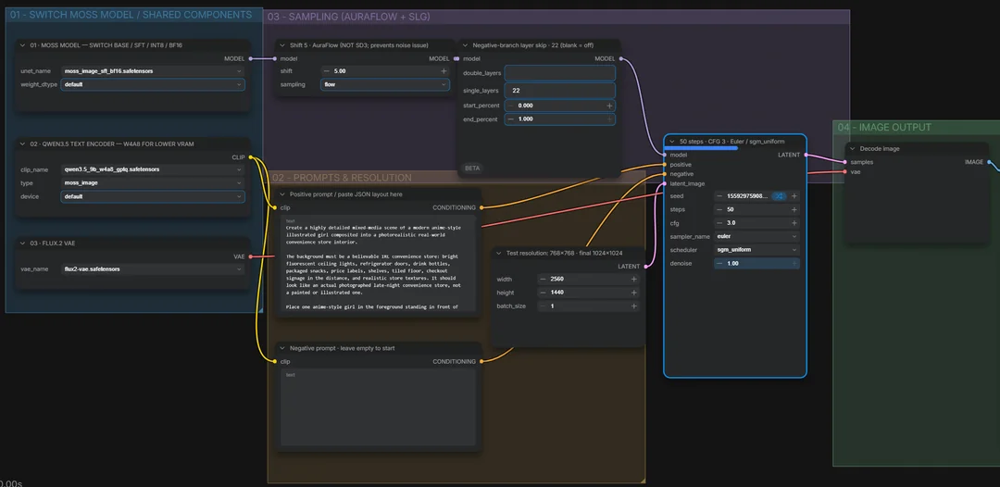

# Native MOSS-Image ComfyUI Workflow

A community-shared **text-to-image ComfyUI workflow** for native MOSS-Image, featuring a single dropdown to swap between **SFT / Base** and **INT8 / BF16** model variants. I assembled it with ChatGPT's help and used it for my local image-generation experiments.

**Not an official OpenMOSS or ComfyUI release.** This repository contains the workflow JSON, **not the model weights**.

## Example workflow + result

Below is a screenshot of the workflow and an example image generated from the prompt visible in that screenshot.

### Workflow screenshot

### Example output

## Get the workflow

Download [`workflows/moss-image-native-universal.json`](workflows/moss-image-native-universal.json), then drag it into ComfyUI or use **Workflow → Open**.

This workflow uses native ComfyUI nodes (not the old `MOSSImageHFLoader`). You need a **ComfyUI core build with native MOSS-Image support**, including the `moss_image` text-encoder type. If `CLIPLoader` reports an invalid type value, update ComfyUI core rather than selecting a different model family.

## Required model downloads

All weights are hosted at **[Comfy-Org / MOSS-Image on Hugging Face](https://huggingface.co/Comfy-Org/MOSS-Image)**. Download the following into the corresponding model folders under your ComfyUI installation (or your configured shared models directory):

| Download | Destination | Notes |
| --- | --- | --- |
| [A MOSS checkpoint](https://huggingface.co/Comfy-Org/MOSS-Image/tree/main/diffusion_models) | `models/diffusion_models/` | Choose **one** variant to start |
| [`qwen3.5_9b_w4a8_gptq.safetensors`](https://huggingface.co/Comfy-Org/MOSS-Image/tree/main/text_encoders) | `models/text_encoders/` | Text encoder |
| [`flux2-vae.safetensors`](https://huggingface.co/Comfy-Org/MOSS-Image/tree/main/vae) | `models/vae/` | VAE |

The model dropdown supports the following files **when installed**:

- `moss_image_sft_int8_convrot.safetensors` — smaller SFT model; good place to start
- `moss_image_sft_bf16.safetensors` — larger SFT model; **selected in the shared JSON**
- `moss_image_base_int8_convrot.safetensors` — Base INT8
- `moss_image_base_bf16.safetensors` — Base BF16

The text encoder and VAE can remain the same while switching MOSS diffusion checkpoints. You do **not** need to download every variant.

## First run

1. Install the model files in the directories shown above, and restart ComfyUI if the loaders don't list them.
2. Import the workflow JSON.
3. In **01 · MOSS MODEL**, select a model file you actually downloaded (use SFT INT8 for an easier first run).
4. Confirm **02 · QWEN3.5 TEXT ENCODER** uses the Qwen model with `type = moss_image`, and **03 · FLUX.2 VAE** points to `flux2-vae.safetensors`.
5. Set width and height to **768 × 768**, with **batch size 1**, for your first test. The shared JSON is saved at a more demanding **2560 × 1440**.
6. Replace the sample prompts if you'd like, and click **Run**.

## Included sampling setup

The shared example is set to:

| Parameter | Saved value |
| --- | --- |
| Checkpoint | `moss_image_sft_bf16.safetensors` |
| Image size | 2560 × 1440 |
| Steps | 50 |
| CFG | 3 |
| Sampler / scheduler | `euler` / `sgm_uniform` |
| `ModelSamplingAuraFlow` | Shift 5; sampling `flow` |
| Skip layer guidance | Single layer `22` |
| Denoise | 1.0 |
| Seed | Fixed example seed |
| Negative prompt | Empty in the shared example |

For testing, keep the same seed and settings when comparing model variants. Switch only the checkpoint in the dropdown.

## Hardware and limitations

I ran MOSS with an **RTX 5080 (16 GB VRAM)** and **32 GB RAM**. At **2560 × 1440**, INT8 generations took around **one minute**, while BF16 took roughly **3–4 minutes** in my tests. Hardware, drivers, settings, and offloading can change generation times considerably.

The model can still make mistakes with background lettering, anatomy, occlusion, and interactions between illustrated characters and realistic objects. Results are not guaranteed to reproduce my examples exactly. This workflow is **text-to-image only**; it is not a dedicated image-reference editing workflow.

## Credits and references

- [Native MOSS-Image integration PR](https://github.com/Comfy-Org/ComfyUI/pull/17095)
- [ComfyUI](https://github.com/Comfy-Org/ComfyUI)
- [MOSS-Image weights](https://huggingface.co/Comfy-Org/MOSS-Image)

Please respect the developers' model licenses. The workflow JSON was prepared with ChatGPT assistance. No model weights are included here.
